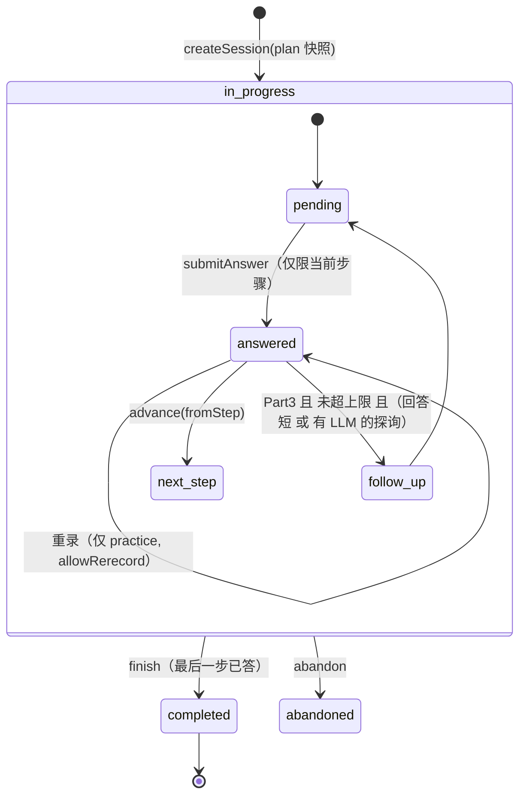

# 架构设计

## 1. 总览
```
Browser (Next.js client)
 ├─ ExamRunner（驱动器，不掌控规则）──► REST API ──► exam-service ──► exam-machine（纯函数状态机）
 ├─ DualRecorder: MediaRecorder(MIME 协商) ∥ WebAudio → 16k WAV              │
 ├─ BrowserTranscriber (Web Speech, 可选)                                     ├─► storage (本地磁盘，可替换为 S3/OSS)
 └─ speak(): 预取缓存 → progressive 流 → 完整缓冲 → speechSynthesis → 字幕      ├─► AI registry ─► ASR / LLM / TTS / Pronunciation providers
                                                                              └─► report-service（after() 异步评分任务）
```
- **状态权威在服务端**：`exam_sessions.current_step` 和每个步骤的 `status`。客户端只是执行者；刷新页面后按服务端状态恢复（这是对目标产品"只存 sessionStorage、刷新丢音频"的改进）。
- **LLM 不控制流程**：`decideAdvance()` 决定 next / follow_up / finish；`full` 模考禁用追问、严格走题库脚本，追问仅在练习模式，LLM 措辞经 `sanitizeFollowUp()` 过滤。
- **题库权威**：`question_sets.is_active` + `season` 决定唯一启用题库，`createSession()` 只从该库按主题抽题（Part 1 = 1 万年保留 + 2 当季，主题下随机）。**Part 3 严格延续 Part 2**：题卡选定后，Part 3 只从该题卡同 `topic_key` 的题集里抽样并按 `order_index` 还原顺序，不跨话题借题；带 Part 3 的考试也只会选择有配套 Part 3 素材的题卡。`configSnapshot` 记录 `bankSeason/bankRegion`。`/admin` 提供导入、切换与内容浏览。
- **评分可缺省**：未配置 AI 评分时 `runScoring()` 直接落 `unscored`，不产生任何 band；四项各 25%，缺项时无正式总分。

## 2. 考试状态机（`src/lib/speaking/exam-machine.ts`）

防重：`fromStep` 必须等于 current_step（重复 advance 返回 duplicate）；答案使用 `idempotency_key` 唯一约束；finish 用条件 UPDATE；插入追问时 `SELECT … FOR UPDATE` 锁定会话，再用两次 UPDATE 平移 step_index，以避开唯一约束冲突。

时间与数量全部写在 `src/lib/speaking/config.ts`，创建会话时整份快照存入 `config_snapshot`。

## 3. 数据模型（`src/db/schema.ts`）
| 表 | 说明 |
|---|---|
| users | 匿名 cookie 用户（以后可接入真实认证），包含目标分和偏好 |
| question_sets / questions | 题库；`module` + `part` + `topic_key`（Part 2/3 共享话题） |
| exam_sessions | `module` 字段为四科扩展预留；mode、status、current_step、config_snapshot |
| exam_questions | 考试中的每一步：kind(question/cue_card/follow_up)、generator(bank/template/llm)、parent_id、prep/answer 秒数 |
| answer_records | 尝试次数（attempt）、is_current、idempotency_key、no_response 状态 |
| audio_assets | recording（浏览器原生容器）与 pcm_wav（16k，用于发音评测），带 sha256 和字节数 |
| transcripts | provider / model / status / words(时间戳) / latency |
| pronunciation_results | 音频评测的逐词结果 |
| assessments | 每次评分一行（重跑会保留历史，便于质量对比）；scorer、llm_model、prompt_version、asr/pron provider、metrics、notes |
| assessment_dimensions | FC/LR/GRA/P 各占一行：band、status(scored/not_assessed)、source、rationale |
| assessment_findings | 句子级证据：dimension、answer_id、kind、category、原句、改写、解释、possible_asr_error |
| exam_reports | 总结与下一步建议 |

## 4. AI 适配器（`src/lib/ai/`）
| 接口 | 实现 | 选择方式 |
|---|---|---|
| ASRProvider | OpenAI 兼容 `/audio/transcriptions`（词级时间戳）；Browser Web Speech | `ASR_PROVIDER` |
| LLMProvider | OpenAI 兼容 Chat Completions；Anthropic Messages | `LLM_PROVIDER` |
| TTSProvider | OpenAI 兼容 `/audio/speech`（含本地 Kokoro）、Azure Neural TTS、浏览器 speechSynthesis | `TTS_PROVIDER` / `auto` |
| PronunciationProvider | Azure Pronunciation Assessment（非脚本模式，ReferenceText=转写文本） | `PRONUNCIATION_PROVIDER` |

所有调用都经过 `withTimeout()`，超时会真正 abort 请求。业务代码只依赖接口。

### 4.1 考官语音链路（`src/lib/ai/tts-text.ts` + `src/lib/audio/speech.ts` + `src/app/api/tts/route.ts`）
```
考试 setup 页
  └─ examLines() 汇总全部台词 → prefetchManyTTS()（并发 2）
       └─ POST /api/tts → 服务端 LRU / in-flight 去重 → 完整缓冲回客户端
            └─ 客户端 blob URL + preload 预解码 → 播放时命中即出声
未预取到（LLM 动态追问）→ GET 流式直接播 → 失败回退 POST 完整缓冲 → 浏览器语音 → 字幕
```
- **自然度**：`toProsodySsml()` / `toAzureSsml()` 插入句间停顿；音色、语速、格式由环境变量控制；Azure 输出 48 kHz 无损 PCM。兼容引擎才发送 `ssml` 字段，OpenAI 官方接口收到的是 `instructions` 语气指令。
- **延迟**：合成完全移出考试关键路径；`X-TTS-Cache` 响应头区分 `hit` / `miss` / `miss-stream`；流式响应在后台 tee 一份写入缓存，供后续重复请求秒回。
- `/api/config` 只暴露引擎信息，密钥不出服务端。

## 4.2 音频性能改造（第一阶段，`feat/speaking-audio-perf-phase1`）

> 只改性能与正确性；题库、评分规则、考试流程与状态机语义均不变。

```
setup 页  ──► AudioPreloader.prepareScript()  ──► TtsScheduler (4 级优先级)
                 ├─ CURRENT    开场 + 第一题（ensureOpeningAndFirst 就绪门）
                 ├─ NEXT       下一题（考生作答期间 prepareNext）
                 ├─ BACKGROUND 其余脚本 / 固定话术
                 └─ LOW        重复问题、no-response 备用反馈（可被抢占取消）
              └─ preloadPresetAudio() 预下载 questionAudioUrl（不再播放时才下载）

播放 say() ─► PlaybackGuard（单一所有者 + generation 去重）
              └─ AudioLifecycle: loading → ready → playing → ended | interrupted | failed
                 缓存命中直接播 → 否则立刻 GET 流式 → 缓冲 POST → 浏览器语音 → 字幕
                 failed 必须用户确认（字幕降级保留），interrupted 直接终止考试循环

提交答案 ─► POST /complete-answer（1 次往返取代 answers + advance + GET session）
              └─ exam-service.completeAnswer(): submitAnswer() → advance() → getSessionView()
                 状态机权威 / 幂等键 / 所有权 / 并发安全全部保留
                 ASR 由 asr-policy.ts 决定：full 永不同步等待；practice Part 3 保留同步

录音 ─────► RecordingSession：整场 1 个 MediaStream + 1 个 AudioContext
             每题 1 个 MediaRecorder + 1 份 PCM 缓冲 → 独立录音文件
             AudioWorklet 优先，失败回退 ScriptProcessorNode（Safari 兼容）
```

- `tts-scheduler.ts` 的 key 包含 `text + voice + model + format`，高优先级任务可抢占低优先级任务并取消其 POST 预加载。
- `/api/tts` 的 GET（实时流）**不再等待** POST 预加载：`tts-cache.ts` 的 in-flight 任务区分 `live` / `prefetch`，`live` 会取消同文本的 `prefetch`。POST 客户端断开即中止合成。
- 性能指标（`metrics.ts`）：`tts_synthesis_ms`、`audio_download_ms`、`audio_ready_ms`、`playback_start_delay_ms`、`recording_duration_ms`、`audio_encoding_ms`、`upload_duration_ms`、`asr_duration_ms`、`advance_duration_ms`、`inter_turn_gap_ms`，并区分 `cache-hit / cache-miss / stream / preset / browser`；开发环境通过 `window.__B9_AUDIO_TRACE__()`、`__B9_AUDIO_METRICS__()`、`__B9_AUDIO_CHAIN__()` 查看完整调用链。
- 真实浏览器音频行为（流式播放、麦克风、AudioWorklet、speechSynthesis）无法在 Node 环境验证，见 `tests/audio-perf.test.ts` 末尾的 BROWSER-ONLY 清单与 `tests/integration.mjs`。

## 5. 评分管线（`report-service.ts`）
1. 转写：补齐缺失的转写（服务端 ASR）。失败的条目写入 notes 并排除在评分之外。
2. 识别出的总词数 < 10：评分直接判为 **failed**，不编造分数。
3. 发音：只用音频模型（WAV）。没有配置时 P=not_assessed，总分标注 Provisional。
4. 语言：LLM（版本化 Prompt + 严格 JSON 校验，引用的原文不在转写中的发现会被丢弃，最多重试 2 次）→ 失败时回退到启发式评分器，并在报告中标注。
5. 总分按 IELTS 规则取整（.25→.5，.75→进位）。

启发式评分器的依据：每题词数、WPM、填充词率、重复、连接词种类、长停顿（需要时间戳）、less-common 词比例、MATTR、复杂结构标记、句长，以及 12 条高精度语法规则（在高水平样本上 0 误报）。

## 6. 前端
- `AppShell`：桌面端侧栏，移动端顶栏加底部 Tab；考试页全屏。
- 页面：`/` Dashboard、`/speaking`、`/speaking/exam/[id]`、`/speaking/report/[id]`、`/speaking/questions`、`/history`、`/settings`、`/listening|reading|writing`（Coming Soon）。
- 浏览器兼容：MIME 协商（Chrome→webm/opus，Safari→mp4/aac）、`webkitAudioContext`、音频接口支持 Range（Safari 的 `<audio>` 需要）、在用户手势中解锁 speechSynthesis。

## 7. 与目标产品的功能对照
见 `docs/reverse-engineering/reverse-engineering-summary.md`。
